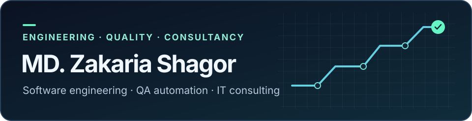

# 

I’m **MD. Zakaria Shagor**, a **Junior IT Consultant at the ISO Project, DGHS**, with 6+ years across software engineering, test engineering, and IT consultancy. My current work includes IT planning, infrastructure oversight, and user acceptance testing for public healthcare systems.

Previously, I led end-to-end QA on the **EDGE Project**, building Playwright and Pytest automation for critical workflows. I’m especially interested in the point where hands-on testing meets requirements, release decisions, and delivery.

[Portfolio](https://zakaria-me.ai.studio/) · [LinkedIn](https://linkedin.com/in/zakariashagor) · [Email](mailto:zakariashagorr@gmail.com)

## Featured projects

### [Healthcare QA Framework](https://github.com/iamzakaria/healthcare-qa-framework)

A QA framework built around a **synthetic healthcare app**. It uses Playwright and Pytest to test patient registration in the browser, exercise scheduling rules through the API, and check database and audit behavior directly.

### [Reel](https://github.com/iamzakaria/reel)

A cross-platform desktop media player that streams from FTP, FTPS, and HTTP sources with subtitle support. The repo includes Playwright tests and [installers for macOS, Windows, and Linux](https://github.com/iamzakaria/reel/releases/tag/v0.2.1).

## What I work with

- **Browser automation:** Playwright, Cypress, Selenium, Pytest
- **API, data, and performance testing:** Postman, SQL, Pandas, JMeter
- **Languages and delivery:** Python, TypeScript, JavaScript, Git, GitHub Actions, Jira

## How I work

- Turn business requirements into test coverage, starting with the user journeys that matter most.
- Automate repeatable regression checks and run them in CI.
- Document defects with clear reproduction steps and explain what they mean for the release.

Open to remote and contract QA automation work.
